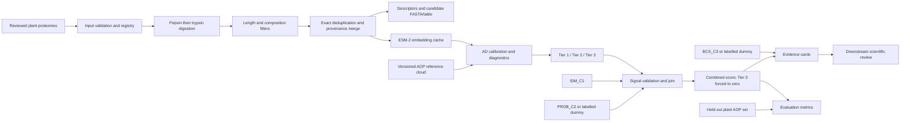

# Component 4 Architecture

## Purpose and boundary

PlantAOP-Screen is a research pipeline that transforms plant proteome records into provenance-traceable peptide candidates, maps candidates relative to an AOP reference distribution, optionally combines upstream positive-evidence signals, and exports ranked evidence. It does not establish antioxidant activity; wet-lab validation remains necessary.

## Planned data flow

This diagram is a target architecture. Only the raw input files, package stub, and GPU probe are present in the repository as of the status snapshot; none of these stages is implemented by the C4 package yet.

## Stage responsibilities and contracts

| Stage | Input | Output contract | Required controls |
|---|---|---|---|
| Proteome intake | UniProt FASTA records | Immutable raw files plus registry | Taxonomy, reviewed status, release/query, retrieval date, checksum, parsed record counts, exclusion counts |
| Digestion | Validated protein sequences | Fragment rows with parent accession, coordinates, enzyme path, and plant | Fixed enzyme definitions/order; missed-cleavage setting; deterministic output |
| Candidate curation | Fragment rows | Filtered, exact-deduplicated candidates with complete provenance | Standard 20-residue alphabet, 3–20 AA, at least two unique residue types; no provenance loss |
| Feature extraction | Candidate IDs and sequences | Descriptor table and optional embedding matrix | Stable row order/IDs; finite values; model manifest; reproducible preprocessing |
| AD calibration | Reference-cloud embeddings and candidate embeddings | Fitted cloud metadata and candidate distance/tier table | Reference source/version; cloud/evaluation disjointness; calibration frozen before scoring |
| Signal integration | Candidate IDs, tiers, C1/C2 scores | Validated joined signal table and score/rank | Unique IDs, range checks, missingness policy, source labels, Tier 3 forced zero |
| Evidence output | Ranked candidates and C3 reliability values | Machine-readable cards and human-readable summaries | Provenance and signal traceability; abstention and dummy-data labels |
| Evaluation | Frozen ranked lists and held-out positives | Per-plant metrics, uncertainty and statistical outputs | Homology isolation; documented evaluation universe and tie handling; no test-set fitting |

## Component boundaries

- **C1 / AOP-ProCon:** proposed source of `SIM_C1` and the primary AOP-BenchPos reference cloud. C4 should consume versioned artifacts, not refit or silently modify C1 outputs.
- **C2 / PU-AOP:** proposed source of `PROB_C2`; probability semantics, model/fold version, calibration, and candidate coverage must accompany the score column.
- **C3 / AOP-BCS:** proposed source of predictor reliability `BCS_C3`. BCS describes predictor behavior, not the biological probability that an individual peptide is active. It must not be misrepresented as a candidate activity score.
- **External tools:** AnOxPePred and Multi-AOP are planned for later cross-predictor auditing. Their scores and failures require source/version/date records.

## Execution modes

The research materials describe a primary inter-component mode and a Stage 0 public-tool fallback. Neither mode is implemented. A future Stage 0 run must name the alternative cloud source, model version, score source, and differences from the primary configuration in its manifest; its outputs must not be merged without provenance into primary-mode results.

## Planned package decomposition

The task inventory proposes modules for ingestion/contracts, digestion/filtering, embeddings/AD, signal validation, scoring, evidence cards, and dummy fixtures. Names and APIs remain to be established during implementation. Avoid treating this conceptual decomposition as a promise of existing imports or CLI commands.
